# Dashboard

[TEST CASES](readme.md)

## Covers

- [Time Log Summary](#time-log-summary)
- [Recent Activity](#recent-activity)
- [Dismissal](#dismissal)
- [Configuration](#configuration)

## Time Log Summary

1. Sign in as a [student](authentication.md#validating-student-sign-in) assigned to an in-progress project and navigate to the Dashboard tab. A "Time Log Summary" section should appear near the top of the dashboard.
    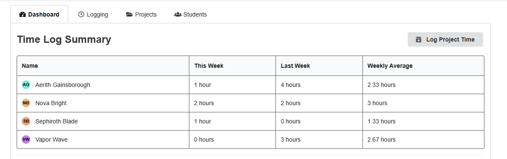

2. The summary should contain one row for every student on the project, including the currently signed-in student. Each row should display the student's name and profile circle alongside the following values:
   - This Week
   - Last Week
   - Weekly Average
    
3. The Time Log Summary should act as a single clickable area. Clicking anywhere within the summary table should open the existing [Time Log Report](logging.md#time-tracking) for that project.

4. Compare the "This Week" and "Last Week" values against the same project's [Time Log Report](logging.md#time-tracking). The values should represent the total active time logged by each student for the corresponding week.
    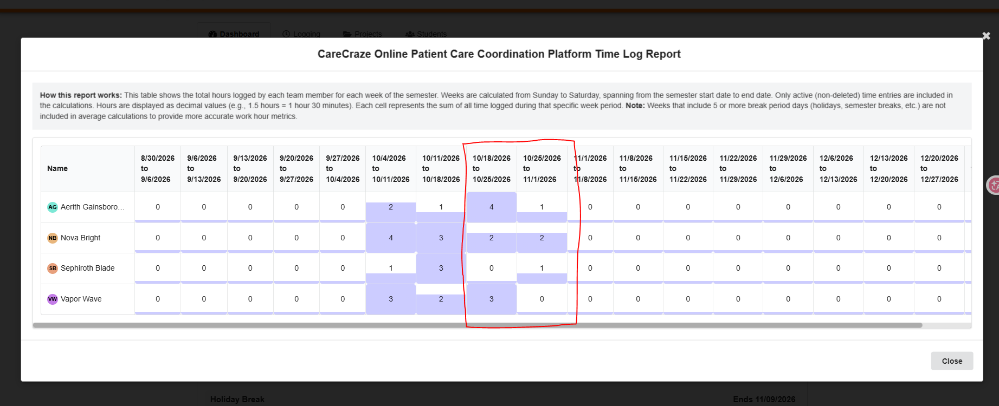

5. Deleted time logs should not contribute to any of the displayed totals.

6. Press the "Log Project Time" button in the top-right of the Time Log Summary. The same time logging modal used in the Logging tab should open.
    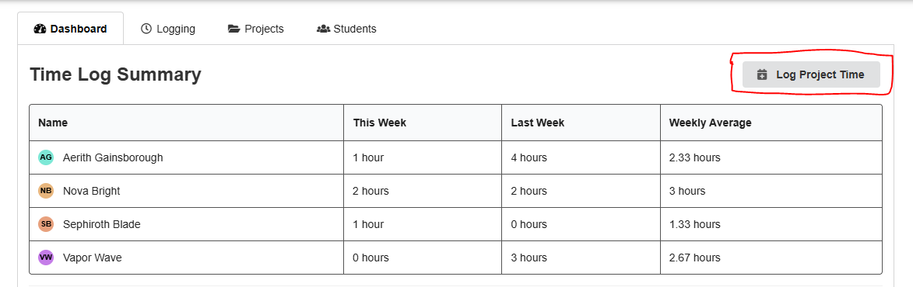
7. Submit a valid time log for the current or previous week. After the submission succeeds, verify that the Time Log Summary updates appropriately and that the same log is visible in the Logging tab.

## Recent Activity

1. Sign in as a student assigned to an in-progress project that contains recent action submissions and overdue actions. A "Recent Activity" section should appear below the Time Log Summary.
    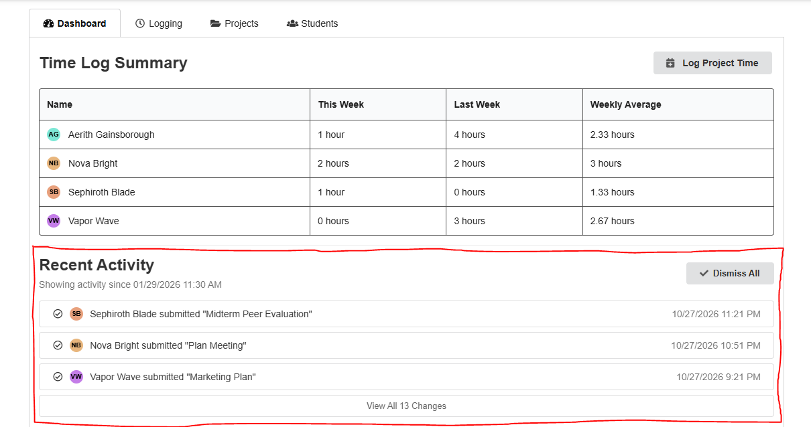

2. The section should display the timestamp used as the current activity cutoff in the "Showing activity since..." text.
    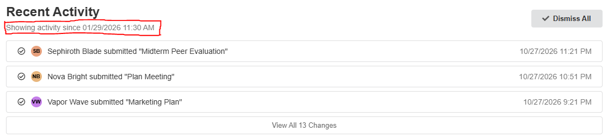

3. Submit an action as a different student on the same project, then return to the original student's Dashboard. The new submission should appear in Recent Activity with:
   - the submitting student's profile circle and name
   - the submitted action's title
   - the correct submission date and time

4. The currently signed-in student's own action submissions should not appear in their Recent Activity feed.

5. Click an action submission in Recent Activity. The existing action/submission view should open and should follow the same visibility rules as that action elsewhere in the portal.
    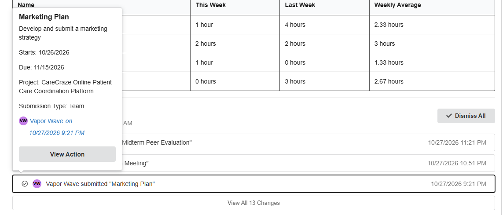
6. Identify an incomplete action whose due date has passed. The action should appear in Recent Activity as an overdue reminder and should display the number of calendar days that it is overdue.
    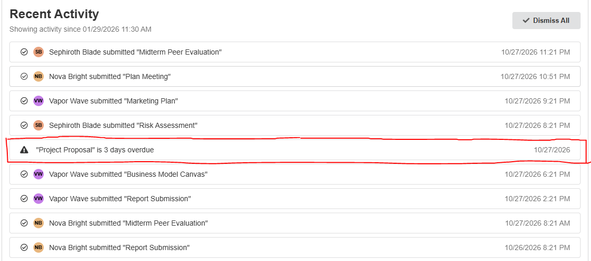

7. If multiple overdue actions are displayed for the same day, actions that have been overdue longer should appear before actions that have been overdue for fewer days.

8. Action submissions and overdue reminders should be ordered chronologically relative to each other. A real submission that occurs later than an overdue reminder's effective timestamp should appear above that reminder.

9. Complete an action that is currently displayed as overdue and reload Recent Activity. The completed action should no longer appear as an overdue reminder.

10. If the number of Recent Activity entries exceeds the configured initial display limit, only the configured number should initially appear and a "View All X Changes" button should be displayed.
    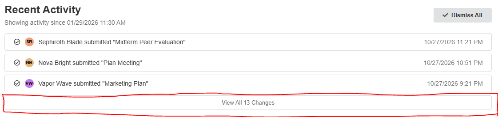

11. Press "View All X Changes" and verify that all available Recent Activity entries appear. Press "Show Less" and verify that the feed returns to its configured initial size.

## Dismissal

1. Sign in as a student with at least one visible Recent Activity entry and press "Dismiss All".
    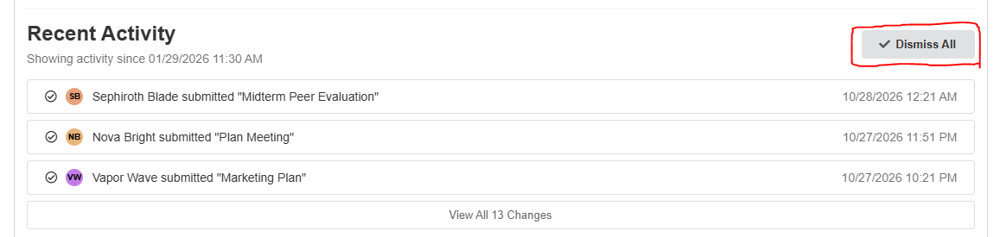

2. All currently visible dismissable Recent Activity entries should disappear.
    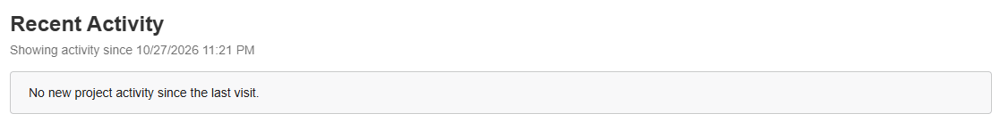

3. Refresh the page and verify that previously dismissed activity remains dismissed.

4. Create a new action submission after the stored dismissal point and reload the Dashboard. The newly created activity should appear even though earlier entries remain dismissed.

5. Sign out and sign back in after new project activity has occurred. The Recent Activity cutoff should use the most recent applicable login/dismissal timestamp and should not redisplay already acknowledged activity.

## Configuration

1. In `ui/src/config/uiConfig.js`, disable the complete Recent Activity dashboard feature and verify that it no longer renders.
    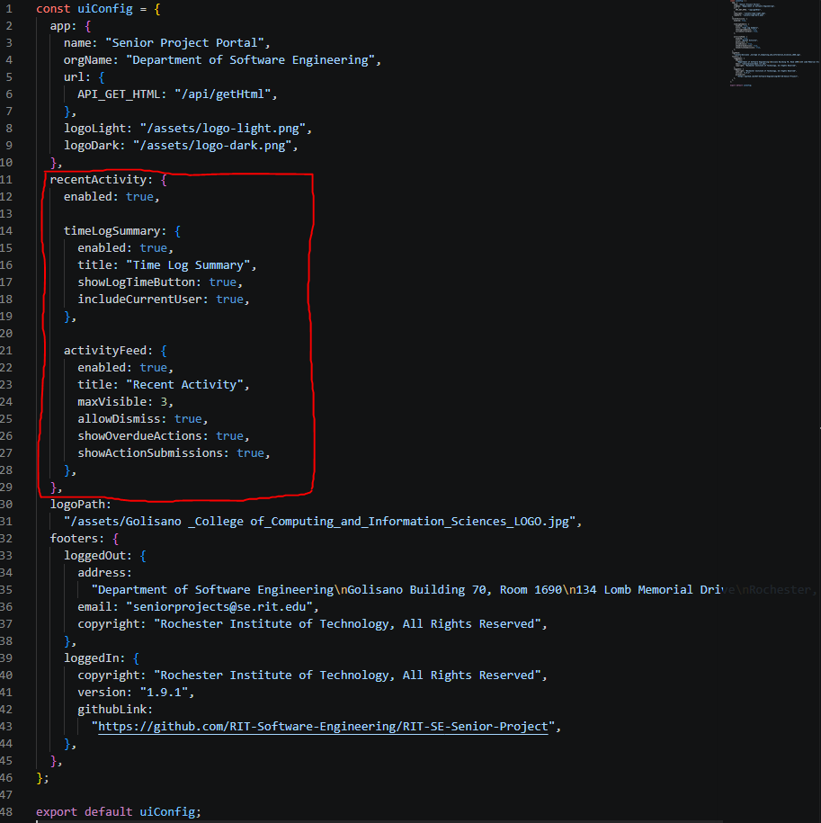

2. Re-enable the feature and independently disable the Time Log Summary. Verify that the summary is hidden while the Recent Activity feed remains available.
    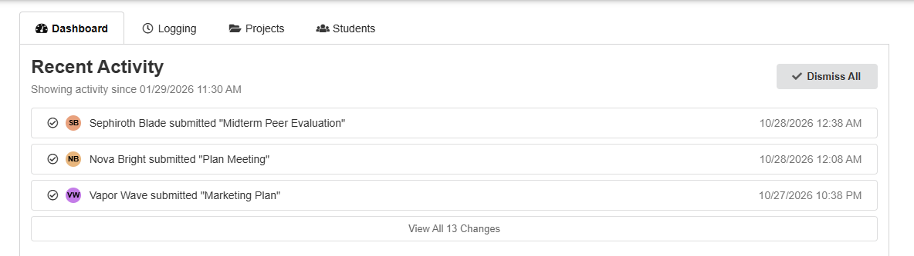

3. Disable the Recent Activity feed and verify that the Time Log Summary can remain visible independently.
    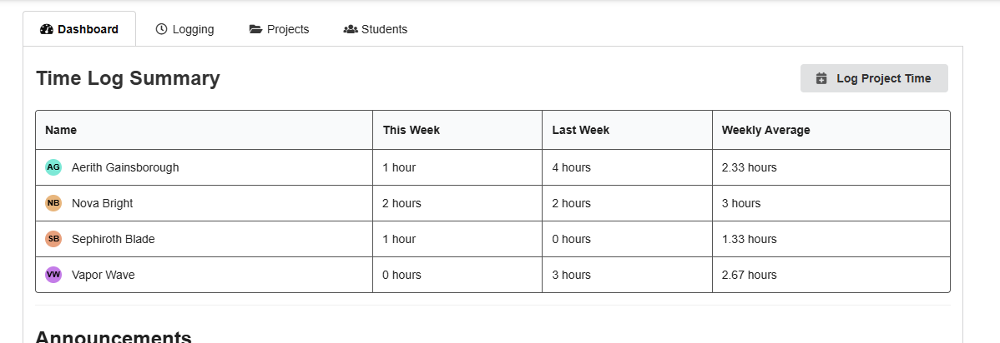

4. Change the configured Time Log Summary and Recent Activity titles and verify that the Dashboard displays the configured values.
    
5. Change the configured maximum number of initially visible Recent Activity entries and verify that the feed and "View All" behavior use the new value.
    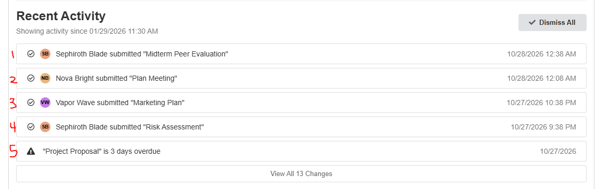

6. Disable overdue action activity and verify that overdue reminders no longer appear while action submission activity still does.

7. Disable action submission activity and verify that teammate submissions no longer appear while overdue reminders still do.

8. Disable dismissal and verify that the "Dismiss All" button is no longer displayed.

9. Disable the "Log Project Time" button and verify that the button is removed without hiding the Time Log Summary.

10. Toggle the configuration controlling whether the current student is included in the Time Log Summary and verify that the student's row appears or disappears accordingly.